<div align="center">

# KafkaCore Lab

**Apache Kafka internals and performance engineering**

A Java framework for **benchmarking**, **regression-testing** and **fault-injecting** Apache Kafka.
It measures throughput, p95/p99 latency and resource use under configurable workloads, then breaks
a 3-node **KRaft** cluster on purpose to check that no acknowledged message is ever lost.


-231F20?logo=apachekafka)


</div>

---

<p align="center">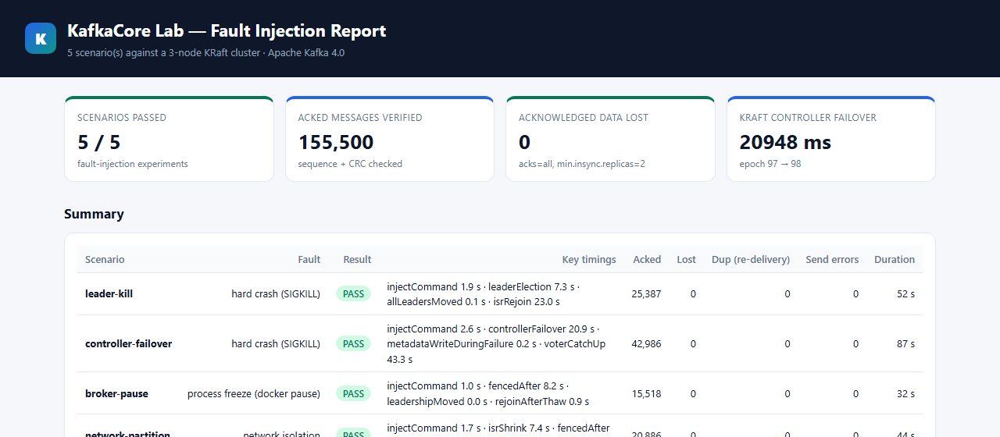</p>

## Contents

- [What it does](#what-it-does)
- [Results](#results)
- [Quick start](#quick-start)
- [Architecture](#architecture)
- [Benchmarking](#benchmarking)
- [Regression testing](#regression-testing)
- [Fault injection & KRaft internals](#fault-injection--kraft-internals)
- [Testing](#testing)
- [Project layout](#project-layout)
- [Architecture Decision Records](#architecture-decision-records)
- [CI/CD](#cicd)
- [Troubleshooting](#troubleshooting)

## What it does

| Capability | How |
|---|---|
| **Configurable workloads** | YAML: partitions, RF, message size, producers/consumers, target rate, any producer/consumer/topic config, and **sweeps** (cartesian product over size × rate × producers) |
| **Throughput** | msg/s and MB/s, produced and consumed, over a measured window after warm-up |
| **p50/p95/p99/p99.9 latency** | HdrHistogram, lock-free; publish (ack) latency **corrected for coordinated omission**, plus end-to-end latency (ADR-0004, ADR-0005) |
| **Resource utilisation** | broker CPU, memory, network and disk via `docker stats`; client CPU, heap and GC via JMX |
| **Message integrity** | every payload carries producer id + gap-free sequence + CRC32C, and every acked message is reconciled: **lost / duplicate / out-of-order / corrupt** (ADR-0006) |
| **Regression gate** | compares against a baseline with per-metric thresholds; PASS / WARN / FAIL with exit code 2 for CI (ADR-0008) |
| **Fault injection** | 5 scenarios: leader SIGKILL, **KRaft controller failover**, broker freeze (GC pause), follower network partition, rolling restart (ADR-0007) |
| **Cluster introspection** | KRaft quorum leader, epoch, high-watermark, voter lag; broker fencing; per-partition leader/ISR; under-replicated partitions |
| **Reports** | JSON (machine), CSV (spreadsheets), Markdown (CI summaries), self-contained **HTML with SVG charts** |

## Results

Everything below comes from real runs on the 3-node KRaft cluster in this repo.

> **Hardware caveat:** these runs used a Windows laptop with 7.7 GB RAM that was **heavily
> memory-constrained** (about 0.5 GB free, constant paging). Kafka's own
> `kafka-producer-perf-test.sh` showed the same ~1 s latencies on this host, so absolute numbers
> reflect the machine, not the framework. On server hardware expect 100–1000× better latency. The
> correctness results (0 lost) don't depend on hardware.

**Resilience: 10/10 integration tests and 5/5 fault-injection scenarios pass. 311,273
acknowledged messages produced during faults, 0 lost, 0 corrupt, 0 re-ordered.**

| Scenario | Key observation (run A / run B) | Acked | Lost |
|---|---|---:|---:|
| `leader-kill` | new partition leader in 7.3 s / 6.1 s (≈ `broker.session.timeout.ms`); ISR re-join 23 s / 32 s | 25,387 / 28,811 | **0** |
| `controller-failover` | KRaft epoch 97→98 / 103→104 (one clean Raft term); CreateTopics with 2/3 voters in 218 / 364 ms | 42,986 / 34,498 | **0** |
| `broker-pause` | frozen broker fenced after 8.2 s / 9.3 s; leadership moved 4 / 12 ms later; re-joined 0.9 s after thaw | 15,518 / 14,612 | **0** |
| `network-partition` | follower out of ISR at 7.4 s / 8.5 s; writes continued at min.insync=2; ISR restored in 13.5 s | 20,886 / 19,103 | **0** |
| `rolling-restart` | 3 controlled restarts, controller last, 17–29 s per node | 50,723 / 58,749 | **0** |

**Throughput vs message size** (`message-size-sweep.yaml`, unthrottled, `acks=all`, RF=3):

| Message size | msg/s | MB/s | publish p99 | Lost |
|---:|---:|---:|---:|---:|
| 128 B | 38,671 | 4.72 | 14.5 s* | 0 |
| 1 KiB | 4,007 | 3.91 | 16.7 s* | 0 |
| 8 KiB | 542 | 4.23 | 17.9 s* | 0 |
| 32 KiB | 137 | 4.27 | 24.5 s* | 0 |

On this host the cluster is **bandwidth-bound at about 4–4.7 MB/s whatever the record size**:
msg/s drops in proportion as records grow. \*Unthrottled runs saturate the cluster, so the
coordinated-omission-corrected latency is dominated by queueing. That's expected, and it's why
the regression baseline uses a fixed rate instead.

**Paced baseline** (`baseline.yaml`, 1 KiB at 2,000 msg/s): 2,283 msg/s, 2.23 MB/s, publish p50
314 ms, 0 lost. A later run on the same host, after Docker's VM had crashed and recovered,
dropped to 1,429 msg/s with p99 up 5×. The **regression gate caught it** and exited with code 2.

What each number means and why: **[docs/kraft-internals.md](docs/kraft-internals.md)**.

## Quick start

**Prerequisites:** JDK 17+, Docker (Desktop) with about 3 GB free for the containers. Gradle is
not needed: the wrapper is included.

```bash
# 1. Build everything and run the 75 unit tests (no Docker needed)
./gradlew build

# 2. Install the CLI
./gradlew :kafkacore-cli:installDist
alias kafkacore=./kafkacore-cli/build/install/kafkacore/bin/kafkacore   # Windows: ...\bin\kafkacore.bat

# 3. Start the 3-node KRaft cluster and wait until it is healthy (quorum + 3 brokers + 0 URP)
kafkacore cluster up
kafkacore cluster status

# 4. Benchmark
kafkacore bench run workloads/smoke.yaml -o results/smoke
kafkacore bench run workloads/message-size-sweep.yaml -o results/size-sweep
open results/size-sweep/report.html

# 5. Gate against the committed baseline (exit code 2 on regression)
kafkacore bench run workloads/baseline.yaml -o results/current \
    --baseline benchmarks/baselines/baseline.json --policy workloads/regression-policy.yaml

# 6. Break things on purpose
kafkacore chaos list
kafkacore chaos run all -o results/chaos
open results/chaos/chaos-report.html

# 7. Full integration + fault-injection test suite
./gradlew :kafkacore-it:integrationTest

# Or all of the above in one go
./scripts/run-all.sh          # Windows: .\scripts\run-all.ps1
```

## Architecture

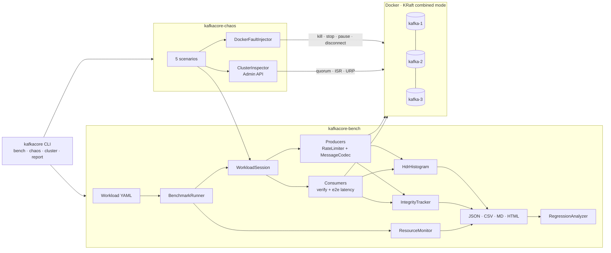

More diagrams (run lifecycle, scenario state machine, module graph) are in
**[docs/architecture.md](docs/architecture.md)**.

| Module | What's inside |
|---|---|
| `kafkacore-bench` | workload model, producer/consumer drivers, rate limiter, payload codec, HdrHistogram recorders, integrity tracker, resource samplers, regression analyzer, report renderers |
| `kafkacore-chaos` | Docker CLI wrapper, fault injector, KRaft/cluster inspector, compose-cluster manager, scenario framework and 5 scenarios |
| `kafkacore-cli` | picocli application `kafkacore` (`installDist` produces launch scripts) |
| `kafkacore-it` | `integrationTest` source set: cluster internals, benchmark pipeline, fault-injection regression suite |

## Benchmarking

A workload is a YAML file. Every field has a default, and unknown keys are rejected so typos
can't silently fall back to defaults.

```yaml
name: baseline-1k-acks-all
topic: kafkacore-baseline
partitions: 6
replicationFactor: 3
messageSizeBytes: 1024
producers: 2
consumers: 2
targetRatePerSec: 2000     # total across producers; 0 = unthrottled
durationSec: 20
warmupSec: 5
producerConfig:            # any Kafka producer property
  acks: all
  enable.idempotence: "true"
  linger.ms: "5"
topicConfig:
  min.insync.replicas: "2"
sweep:                     # optional: one run per combination
  messageSizeBytes: [128, 1024, 8192]
  targetRatePerSec: [1000, 2000]
```

Bundled workloads (`workloads/`):

| File | Question it answers |
|---|---|
| `smoke.yaml` | Does the pipeline work end to end? (about 15 s) |
| `baseline.yaml` | Reference point for the regression gate |
| `message-size-sweep.yaml` | How do throughput and tail latency scale with record size? |
| `load-ramp.yaml` | Where is the latency knee as offered load rises? |
| `acks-comparison.yaml` | What does `acks=all` cost compared with `acks=1`? |
| `compression-lz4.yaml` | What does compression do to throughput? |

> The bundled rates are **laptop-sized**. On server hardware, raise `targetRatePerSec`, or set it
> to `0` for unthrottled runs.

**How it measures:**

1. Creates a fresh topic per run and waits until every partition has a leader.
2. Starts consumers and waits until the group owns **every** partition, so rebalancing never
   shows up as latency.
3. Starts producers on an **open-loop** schedule, then waits until the pipeline is live (first
   ack and first consume).
4. Runs the warm-up, then **discards** it (JIT, connections, metadata).
5. Records the measurement window: per-second timeline, interval p99, broker and client
   resources.
6. Stops producers, flushes (every send ends acked or failed), and drains consumers until
   *received ⊇ acked*.
7. Reconciles integrity, writes `results.json`, `results.csv`, `summary.md` and `report.html`.

<p align="center">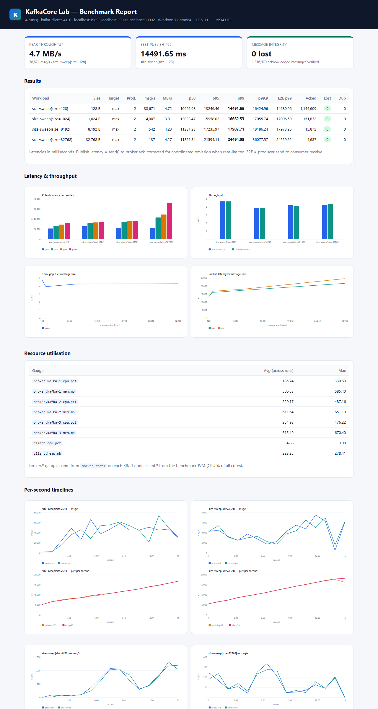</p>
<p align="center">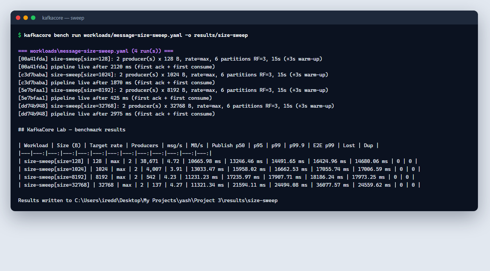</p>

## Regression testing

```bash
kafkacore bench compare --baseline benchmarks/baselines/baseline.json \
                        --current results/current/results.json \
                        --policy workloads/regression-policy.yaml \
                        --markdown summary.md --html regression.html
echo $?   # 0 = PASS/WARN, 2 = FAIL
```

| Metric | FAIL if worse by | Notes |
|---|---|---|
| produce/consume throughput | 10% | |
| publish p95 / p99 | 20% / 25% | ignored below a 1 ms absolute change (noise floor) |
| end-to-end p99 | 30% | |
| lost + corrupt messages | any | integrity always fails hard |

WARN appears at half a threshold, and IMPROVED is flagged too. In CI the gate benchmarks the base
branch and the PR **on the same runner**, because baselines don't carry across hardware
(ADR-0008).

<p align="center">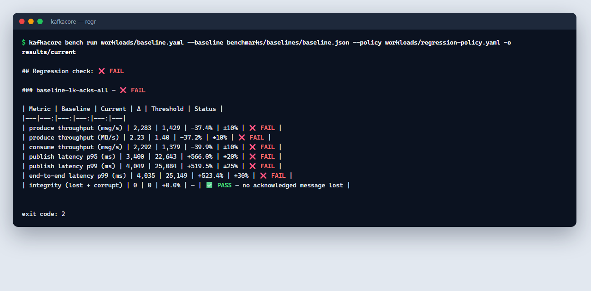</p>
<p align="center">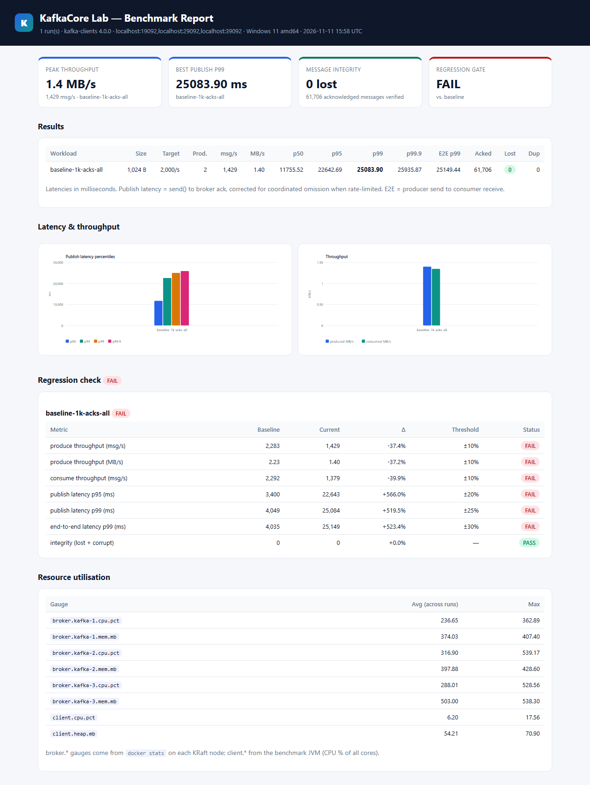</p>

## Fault injection & KRaft internals

Every scenario runs a durable integrity workload (`acks=all`, idempotent, RF=3,
`min.insync.replicas=2`), injects one fault, measures how the cluster reacts, heals it, and then
proves **every acknowledged message survived**.

| Scenario | Fault | What it shows |
|---|---|---|
| `leader-kill` | SIGKILL the partition leader | broker fencing, ISR-based leader election, log truncation and ISR re-join |
| `controller-failover` | SIGKILL the active KRaft controller | Raft election, epoch bump, metadata writes with 2/3 voters, voter catch-up |
| `broker-pause` | `docker pause` (frozen JVM) | GC-pause behaviour: fencing, leader movement, idempotent retries, re-registration |
| `network-partition` | disconnect a follower | ISR shrink at `replica.lag.time.max.ms`, writes continue at min.insync=2, ISR expand |
| `rolling-restart` | SIGTERM each node, controller last | controlled shutdown, zero-loss upgrade procedure |

<p align="center">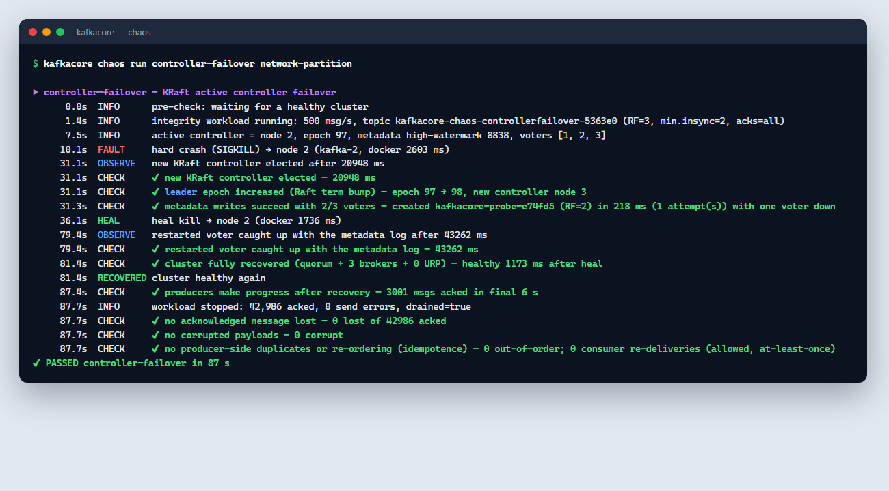</p>
<p align="center">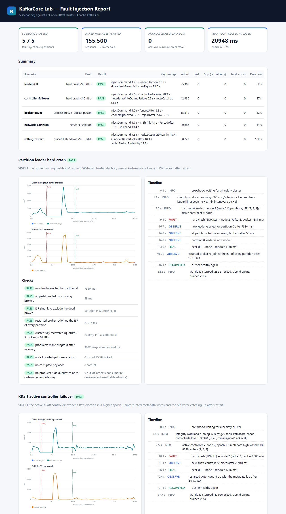</p>
<p align="center">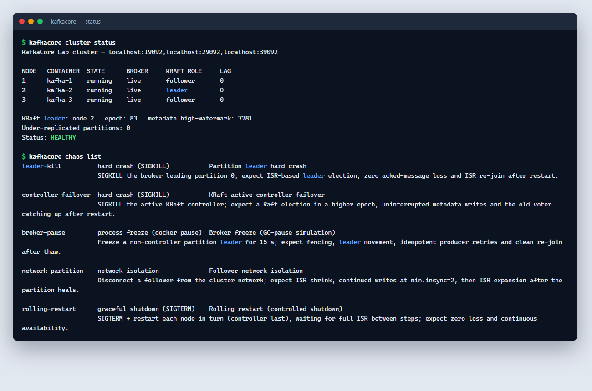</p>

Write-ups: **[docs/fault-injection.md](docs/fault-injection.md)** (how scenarios work, how to add
one) and **[docs/kraft-internals.md](docs/kraft-internals.md)** (what we observed and why).

## Testing

| Suite | Count | Needs | Command |
|---|---|---|---|
| Unit | **75** | JDK only | `./gradlew test` |
| Integration: cluster internals | 4 | Docker | `./gradlew :kafkacore-it:integrationTest --tests '*ClusterInternalsIT'` |
| Integration: benchmark pipeline | 1 | Docker | `... --tests '*BenchmarkPipelineIT'` |
| Integration: fault-injection regression | 5 | Docker | `... --tests '*FaultInjectionIT'` |

The unit tests use Kafka's `MockProducer` / `MockConsumer` for the drivers and a recording fake
for Docker commands, so the fault-injection logic is checked without breaking anything.
Coverage: `./gradlew test jacocoTestReport` writes `*/build/reports/jacoco/test/html/index.html`.

<p align="center">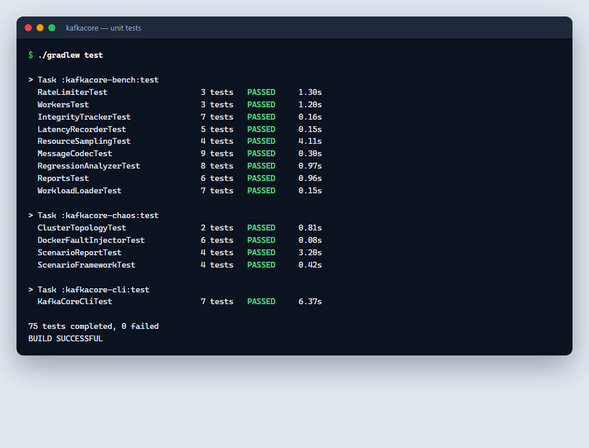</p>
<p align="center">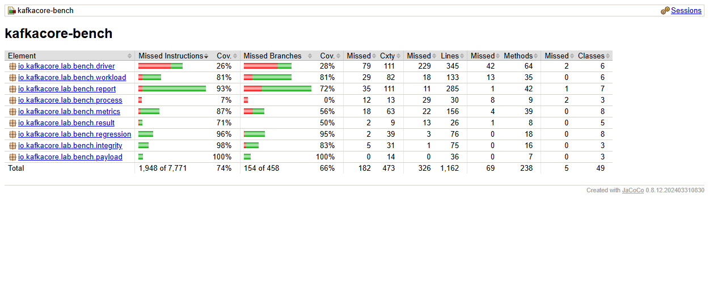</p>

## Project layout

```
kafkacore-lab/
├── buildSrc/                      # convention plugin: Java 17, -Werror, JUnit, JaCoCo
├── gradle/libs.versions.toml      # single source of dependency versions
├── docker/docker-compose.yml      # 3-node KRaft cluster (combined mode)
├── workloads/                     # benchmark YAMLs + regression-policy.yaml
├── benchmarks/baselines/          # committed baseline results
├── kafkacore-bench/               # benchmark engine
│   └── src/main/java/io/kafkacore/lab/bench/
│       ├── workload/  payload/  driver/  metrics/  integrity/
│       └── result/  regression/  report/  process/
├── kafkacore-chaos/               # fault injection
│   └── src/main/java/io/kafkacore/lab/chaos/
│       ├── docker/  fault/  cluster/  scenario/  report/
├── kafkacore-cli/                 # `kafkacore` command
├── kafkacore-it/                  # integration + chaos regression tests
├── docs/
│   ├── adr/                       # 9 architecture decision records
│   ├── architecture.md  fault-injection.md  kraft-internals.md
│   └── screenshots/
├── scripts/run-all.sh | run-all.ps1
└── .github/workflows/ci.yml       # unit → integration → benchmark regression gate
```

## Architecture Decision Records

| # | Decision |
|---|---|
| [0001](docs/adr/0001-record-architecture-decisions.md) | Record architecture decisions |
| [0002](docs/adr/0002-gradle-multi-module-build.md) | Gradle multi-module build with a version catalog |
| [0003](docs/adr/0003-kraft-combined-mode-cluster.md) | 3-node KRaft cluster in combined mode |
| [0004](docs/adr/0004-hdrhistogram-and-coordinated-omission.md) | HdrHistogram + coordinated-omission correction |
| [0005](docs/adr/0005-in-process-end-to-end-latency.md) | End-to-end latency from an embedded timestamp |
| [0006](docs/adr/0006-self-verifying-payload-integrity.md) | Self-verifying payloads for integrity checks |
| [0007](docs/adr/0007-docker-cli-fault-injection.md) | Fault injection through the Docker CLI |
| [0008](docs/adr/0008-baseline-regression-gating.md) | Baseline comparison with relative thresholds |
| [0009](docs/adr/0009-test-pyramid-unit-vs-integration.md) | Docker-free unit tests vs cluster integration tests |

## CI/CD

`.github/workflows/ci.yml` runs three jobs:

1. **Build & unit tests:** `./gradlew build`, with test and JaCoCo reports uploaded.
2. **Cluster integration + fault injection:** starts the compose cluster, runs
   `integrationTest`, and posts the chaos summary to the job summary. Broker logs are dumped on
   failure.
3. **Benchmark regression gate:** on PRs, benchmarks the base branch and the PR head on the same
   runner and fails the job when `bench compare` exits with 2.

## Troubleshooting

| Symptom | Cause and fix |
|---|---|
| `cluster status` shows `TimeoutException` | Brokers are still starting: wait for `kafkacore cluster up` to report healthy. |
| Very high latency (seconds) on a laptop | The host is short of RAM or CPU: close other containers and apps. Kafka's own `kafka-producer-perf-test.sh` will show the same thing, which confirms the cause is the environment and not the client. |
| A node left paused or disconnected after Ctrl-C | Run `kafkacore cluster up`: `ensureHealthy` repairs leftovers. |
| Integration tests are *skipped* | No Docker daemon was reachable. Start Docker Desktop. |
| Port 19092/29092/39092 already in use | Stop the other Kafka, or change the ports in `docker/docker-compose.yml` and `ClusterTopology.local()`. |

## License

MIT. See [LICENSE](LICENSE).
