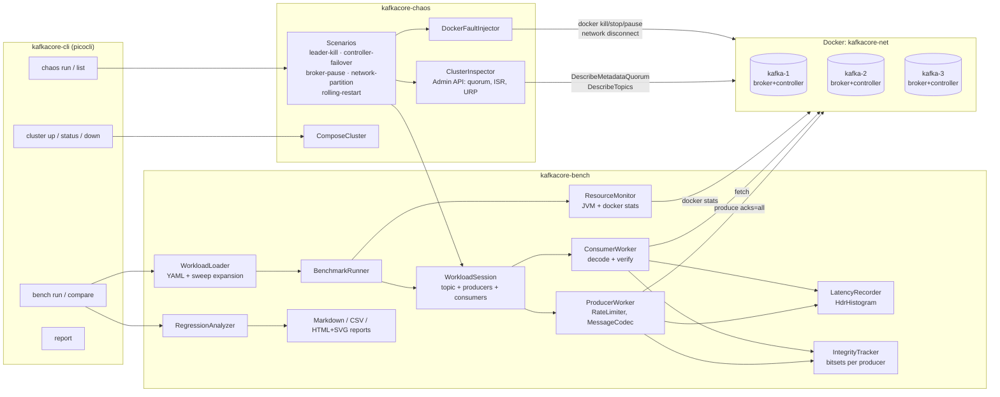
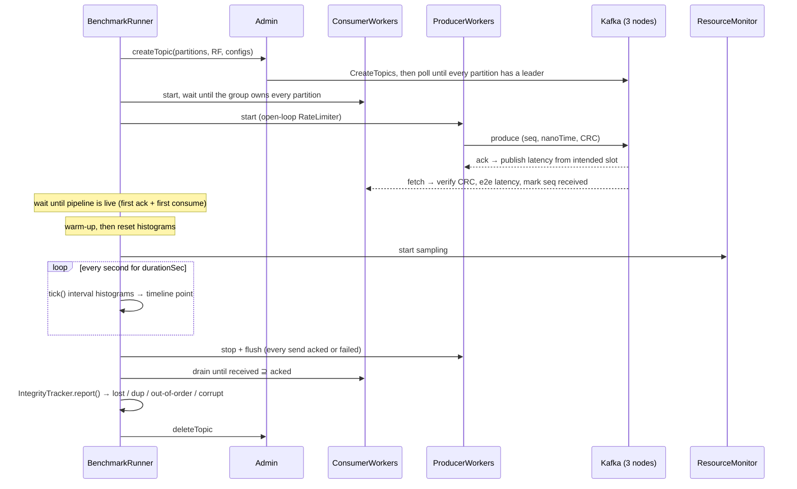
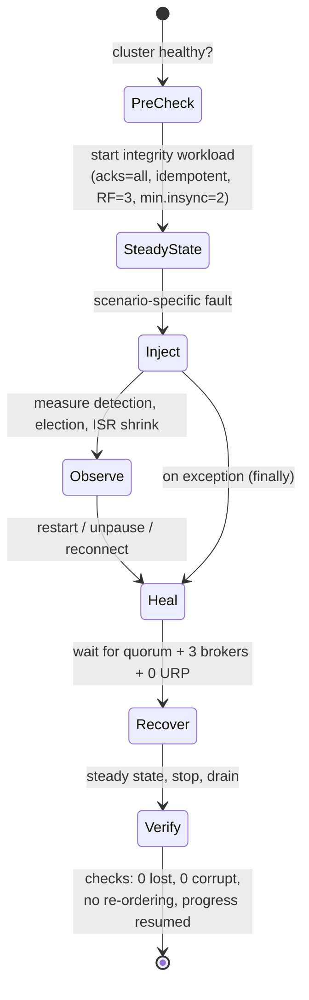
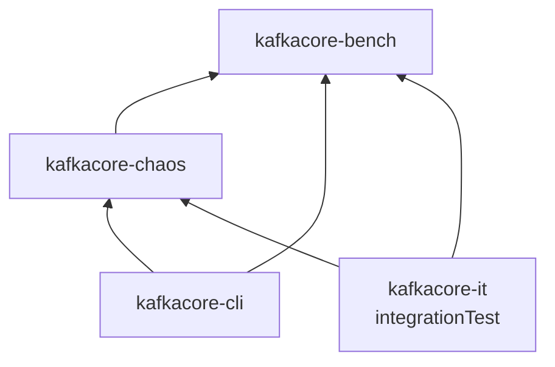

# Architecture

KafkaCore Lab has three layers. A **benchmark engine** generates load and measures it. A
**fault-injection layer** breaks the cluster on purpose and watches it recover. A **CLI and test
harness** drives both from a terminal or CI. All of them target a 3-node Apache Kafka 4.0 cluster
running in KRaft mode in Docker.

## Component view

## Benchmark run lifecycle

## Chaos scenario lifecycle

Every scenario extends `AbstractScenario`, which enforces the same experiment structure:

## Module dependency graph

## Key types

| Type | Module | Responsibility |
|---|---|---|
| `WorkloadSpec` / `WorkloadLoader` | bench | YAML schema, defaults, validation, sweep expansion |
| `MessageCodec` | bench | 25-byte self-verifying header (ADR-0006) |
| `RateLimiter` | bench | open-loop pacing, intended-time latency (ADR-0004) |
| `ProducerWorker` / `ConsumerWorker` | bench | one thread each, latency + integrity bookkeeping |
| `WorkloadSession` | bench | topic, consumer group and producer lifecycle (shared by benchmarks and chaos) |
| `LatencyRecorder` | bench | HdrHistogram `Recorder`, interval ticks + cumulative summary |
| `IntegrityTracker` | bench | acked / failed / received bitsets → `IntegrityReport` |
| `ResourceMonitor` | bench | per-sampler schedules, avg/max aggregation |
| `RegressionAnalyzer` | bench | baseline matching, thresholds, PASS/WARN/FAIL (ADR-0008) |
| `ClusterInspector` | chaos | KRaft quorum, live brokers, partition leader/ISR, URP |
| `DockerFaultInjector` | chaos | KILL / STOP / PAUSE / NETWORK_PARTITION (ADR-0007) |
| `AbstractScenario` | chaos | experiment template, timeline, checks, guaranteed heal |
| `KafkaCoreCli` | cli | `bench`, `chaos`, `cluster`, `report` commands and exit codes |
